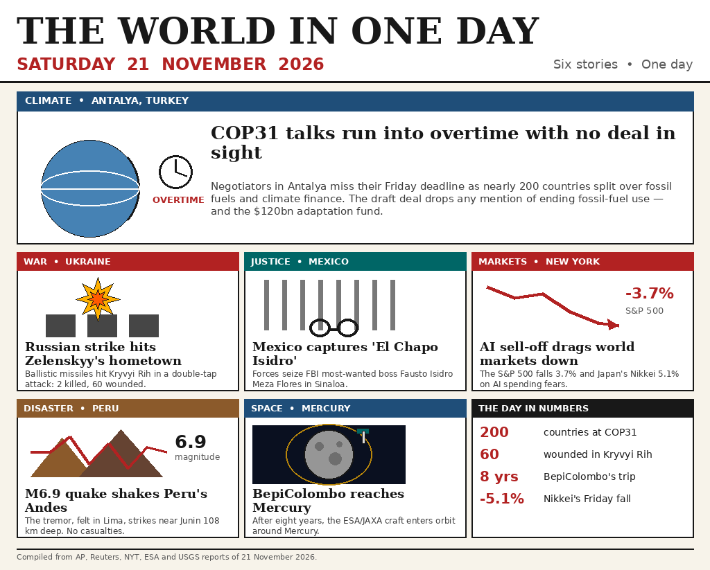

[](https://make.fun/bounty/news-image-20261121?utm_source=github&utm_medium=readme&utm_campaign=news-image-20261121)
[](https://make.fun/bounty/news-image-20261121/leaderboard?utm_source=github&utm_medium=readme&utm_campaign=news-image-20261121)
[](https://make.fun/bounty/news-image-20261121?utm_source=github&utm_medium=readme&utm_campaign=news-image-20261121)

# news-image-20261121 — The World in One Day

A make.fun bounty entry: one image that sums up the world news of
Saturday 21 November 2026.



## The day's stories

- **COP31, Antalya** — climate talks run into overtime with no deal; the
  draft drops fossil fuels and the $120bn adaptation fund.
- **Kryvyi Rih, Ukraine** — a Russian double-tap ballistic strike kills 2
  and wounds 60 in Zelenskyy's hometown.
- **Sinaloa, Mexico** — forces capture FBI most-wanted cartel boss
  "El Chapo Isidro" (Fausto Isidro Meza Flores).
- **Markets** — an AI stock sell-off: the S&P 500 falls 3.7%, the Nikkei
  5.1%.
- **Peru** — a magnitude 6.9 quake shakes the Andes near Junin, felt in
  Lima; no casualties reported.
- **Mercury** — ESA/JAXA's BepiColombo enters orbit after an eight-year
  journey.

## How it is built

`draw_image.py` draws the 1024×823 broadsheet with Pillow at build time
from the verified stories above. `main.py` (Python 3.13, standard library
only) copies `entry.png` to the output directory, so both graded runs
write identical bytes:

```sh
MAKEFUN_OUTPUT_DIR=out python3 main.py
```

Sources: AP, Reuters, NYT, ESA and USGS reports of 21 November 2026.
